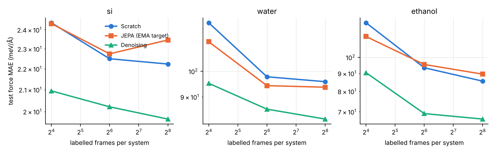
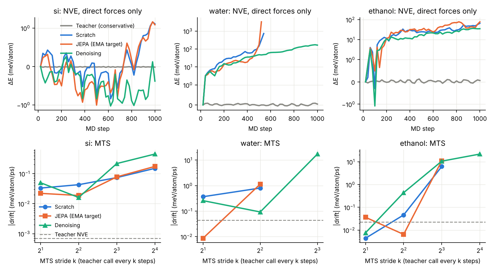

# JEPA pretraining for direct-force MLIPs: CPU pilot (lighter plan)

**Question.** Direct-force MLIPs skip the backward pass that conservative models need
(F = −∂E/∂R), but their forces aren't conservative, so NVE MD drifts. Can JEPA-style
self-supervised pretraining help a direct-force student with (a) **force accuracy when labels
are scarce**, and (b) **being closer to conservative**: less curl, less NVE drift, and a larger
usable stride in multiple time-stepping (MTS)?

**Scope.** This is a *pilot*: CPU only, one seed, small models, short MD. It tells us whether
the idea is worth a proper GPU study. It does not settle the question.

## Setup

| | |
|---|---|
| Teacher / "ground truth" | MACE-MP-0 *small* (float32), used for labels, for measuring true energy in MD, and as the conservative corrector in MTS |
| Systems | bulk Si (64 atoms, PBC), liquid water (27 H₂O, 81 atoms, PBC), ethanol (9 atoms, gas phase) |
| Data | Langevin MD with the teacher over a temperature ladder. **Pool**: 800 frames/system (Si 300–1200 K, water 250–400 K, ethanol 200–800 K). **Test**: 160 frames/system from an independent run at different temperatures. |
| Student | PaiNN, 64 features, 3 interaction layers, 5 Å cutoff (~170k params). **Direct** force head (gated equivariant vector block) plus a per-atom energy head. Forces never use autograd. |
| Arms | **scratch**; **JEPA** (EMA target encoder); **denoising** (Zaidi et al.-style noise prediction, σ = 0.05 Å) |
| Pretraining | Whole unlabelled pool (2400 frames), 2000 steps, batch 8 |
| Fine-tuning | 16 / 64 / 256 labelled frames per system, 1500 steps, batch 8, AdamW 1e-3 cosine, loss = F-MSE + 0.1·E-MSE, best checkpoint on a fixed 32-frame/system validation set. Same recipe for every arm. |

### JEPA objective (as implemented)

* **Context view:** spatial *block masking*. Random centre atoms plus all atoms within 2.6 Å
  are masked until ≥15 % of each structure is covered (capped at 40 %). Masked atoms keep their
  positions, but their species becomes a learned `[MASK]` token, so the context encoder must
  infer what sits there from the surrounding geometry and chemistry.
* **Target:** the EMA copy of the encoder (momentum 0.996 → 1, cosine) sees the full,
  unmasked structure. Its final **scalar *and* vector (l = 1)** per-atom features are the targets.
  Scalars are LayerNorm-ed; vectors are normalised by their per-atom RMS norm. Keeping the
  equivariant vector channel is deliberate: forces are vectors, and scalar-only targets would
  throw away exactly the directional information a force head needs.
* **Predictor:** a 2-layer PaiNN on the context graph, loss = MSE on masked atoms only.
* Fine-tuning starts from the **EMA (target) encoder**, as in I-JEPA.

### Metrics

1. **Force MAE vs. number of labels**, per system, on the independent test trajectories.
2. **Non-conservativeness:** ‖½(J − Jᵀ)‖ / ‖J‖ with J = ∂F/∂R (full 3N×3N Jacobian by
   autograd, 4 test frames/system). A conservative field has a symmetric J (it is a Hessian),
   so this is 0. A random linear map gives ≈ 0.71.
3. **NVE drift** with direct forces only: 1000 steps (Si 1 fs, water/ethanol 0.5 fs). Energy is
   measured as *teacher* PE + KE, i.e. the quantity a perfect model would conserve.
4. **MTS stride:** impulse r-RESPA as in Bigi et al. (2025). Inner velocity-Verlet with
   student forces; every *k* steps a kick of (F_teacher − F_student)·k·dt/2 at both ends of
   the outer step. We report drift vs. *k* ∈ {2, 4, 8, 16}. The teacher stands in for the
   conservative fine-tuned model that would play this role in practice.
5. **Cost:** ms per force call, direct head vs. −∂E/∂R, same PaiNN, Si cells of 64–512 atoms.

## Findings (single seed, so treat differences under ~5 % as noise)

Full tables: [`results/summary.md`](results/summary.md). Figures: `results/figs/`.



**1. Label efficiency: JEPA helps only in the lowest-data regime, and less than denoising.**

| mean test force MAE (meV/Å) | 16 labels/system | 64 | 256 |
|---|---|---|---|
| scratch | 90.6 | 71.2 | 67.8 |
| JEPA (EMA target) | 83.9 (−7 %) | 70.8 (≈0) | 68.9 (+2 %) |
| denoising | **68.8 (−24 %)** | **58.3 (−18 %)** | **56.2 (−17 %)** |

JEPA's gain at 16 labels comes from water and ethanol. On Si it does nothing, and by 64 labels
it has vanished. Denoising wins on every system at every budget. This fits the concern from
our earlier discussion: forces live in fine geometric detail, and denoising targets that detail
directly (on near-equilibrium data the noise-prediction target ≈ a force field), while JEPA's
latent prediction is free to discard it. Keeping vector targets in the JEPA loss did not close
the gap.

**2. Conservativeness: pretraining doesn't make direct forces "more conservative" beyond what
better accuracy explains.** Jacobian asymmetry is small for all students (Si ≈ 0.016,
water 0.024–0.053, ethanol 0.035–0.087; random ≈ 0.71). Its ranking tracks force MAE exactly
(denoise < JEPA < scratch at 16 labels; near-identical at 256). No arm shows a curl reduction
that its error doesn't account for.

**3. NVE with direct forces alone is not usable for any arm** (confirms Bigi et al.). Drift is
2–4 orders of magnitude above the conservative teacher: Si ≈ 0.6–1 meV/atom/ps vs 0.0007;
ethanol 70–130 vs 0.02. Water *explodes* for scratch and JEPA within ~0.27 ps. Denoising
survives the run but drifts at 340 meV/atom/ps. JEPA was not better than scratch on any system.

**4. MTS rescues all arms equally; the stride ceiling is set by the integrator, not the student.**
With a conservative correction every k = 2–4 steps, drift drops to 0.01–1 meV/atom/ps for every
arm, with no consistent ranking between arms. Si (no H) stays stable up to k = 16 for all
arms. Water and ethanol fail or drift strongly at k ≥ 8 for *every* arm, including the most
accurate one. An outer step of k·dt = 4 fs is close to half the O–H/C–H stretch period, which is
the classic r-RESPA resonance, so a better student would not raise this ceiling.

**5. Cost.** On CPU the direct head is 1.9–2.6× cheaper than −∂E/∂R with the same PaiNN
(64–512 atoms). JEPA pretraining cost ~2.2× more per step than denoising: an extra target
forward pass plus the predictor.



### Verdict on the original idea

In this pilot, JEPA pretraining is **not** a good route to better direct-force MLIPs. It gives a
modest low-data gain that denoising beats at lower cost. It does not reduce non-conservativeness
or NVE drift. The things that actually made direct-force MD work here were the known ones:
a better-fitting student (denoising) and MTS with a conservative corrector.

If you want to keep pushing JEPA, the experiments most likely to change this conclusion are:

* **A hybrid objective:** JEPA plus a denoising/force-like auxiliary on the same encoder, or a
  JEPA context view that adds coordinate noise. This tests whether JEPA adds anything *on
  top of* denoising, which is the comparison that matters.
* **The skipped arms from the full plan:** JEPA with the *teacher* (MACE) as the target encoder
  versus plain feature distillation. A frozen, force-aware target removes JEPA's freedom to
  discard force-relevant detail.
* **Multiple seeds and more fine-tuning steps.** Scratch at 64 vs 256 labels barely differs,
  so 1500 steps limits fine-tuning more than the label count does.

### Caveats

One seed; small students (~170k params) with short training; the teacher is MACE-MP-0 small,
not DFT; in MTS the teacher stands in for a conservatively fine-tuned student; the JEPA masking
ratio, radius, EMA schedule and predictor depth were not tuned; MD runs are only 0.5–1 ps.

## Reproduce

```bash
pip install torch mace-torch ase matplotlib
cd jepa_mlip_pilot
./run_all.sh          # data generation ≈ 35 min (3 parallel procs), everything else ≈ 1.5 h on 4 cores
```

`results/summary.md` holds all tables (auto-generated). Figures are in `results/figs/`.
Raw per-run JSON is in `results/`.
